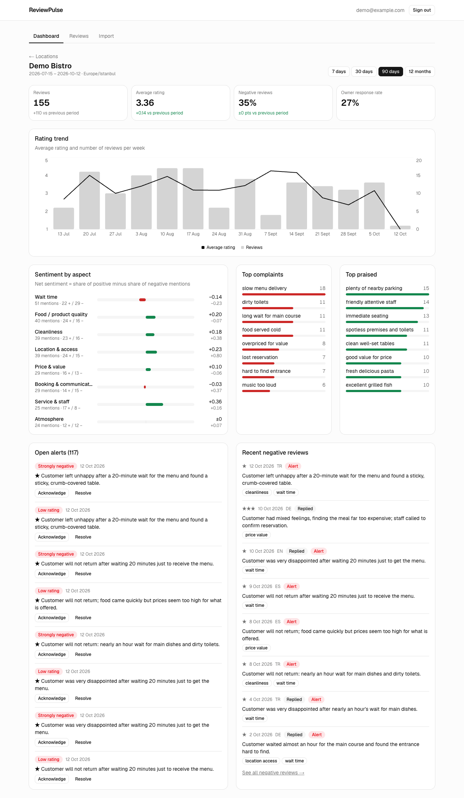
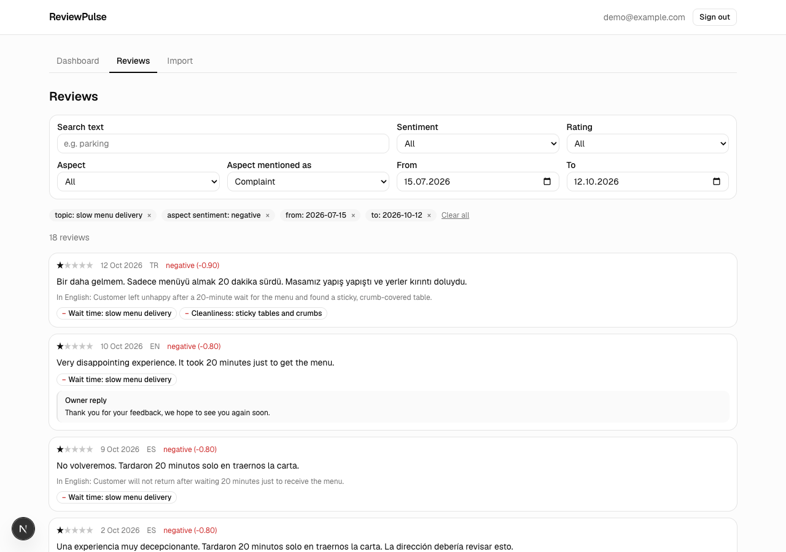

# ReviewPulse

**Customer satisfaction intelligence for service businesses.**

ReviewPulse collects a business's customer reviews in one place, reads them with AI
in any language, and turns them into a clear picture: what customers love, what they
complain about, what changed this week, and which reviews need attention today.

It is built for restaurants, cafés, hotels, tour operators, clinics and retail stores:
businesses that get reviews in several languages and don't have time to read them
all.

> **Status:** private beta in development. This repository holds public information
> about the product; the source code is private.

---

## What it does

**One dashboard per location**
- Review count, average rating, share of negative reviews and owner response rate,
  each compared with the previous period
- Rating trend by day, week or month
- Sentiment for each part of the experience: service & staff, cleanliness, price &
  value, food / product quality, wait time, location & access, atmosphere, booking &
  communication
- Top praised and top complained-about topics ("slow menu delivery", "friendly
  attentive staff"), each one click away from the reviews behind it

**Reads every language, reports in one**
- Reviews in Turkish, English, German, Spanish and other languages are analyzed
  directly. Insights and summaries come out in English.
- The same complaint written in different languages is grouped under the same topic.

**Alerts that don't cry wolf**
- Alerts for reviews that need a reaction: health and safety issues, legal threats,
  discrimination, a furious 1-star review, or a 5-star rating that hides a serious
  complaint
- Grouped alerts when the same problem keeps coming back ("3 complaints about wait
  time this week")
- Thresholds can be adjusted per location: a hotel chain and a small café have
  different tolerances
- After the first import, a one-time list of older reviews worth a look, so nothing
  serious is buried in the backlog

**Review explorer**
- Filter by text, rating, sentiment, aspect, topic and date
- Every review shows its AI summary, the aspects it mentions and the owner's reply

## Getting reviews in

ReviewPulse only uses official and permitted sources: **no scraping**.

| Source | Status |
|---|---|
| CSV / JSON upload (exports from other tools or your own records) | ✅ available |
| Google Business Profile (owner connects their account) | planned |
| Licensed third-party review data providers | planned |

Re-uploading the same file is safe: duplicates are skipped and edited reviews are
updated.

## Privacy

- Reviewer names are stored only as a one-way hash by default, and they are never
  sent to the AI.
- Any review can be permanently deleted on request (GDPR / KVKK).
- Each business only ever sees its own data.

## How the AI works

- Cheap steps run first: language detection runs locally, and reviews with only a
  star rating are scored without AI.
- Reviews are analyzed in batches with structured, validated output, using
  **Anthropic's Claude** models. A fast, low-cost model handles review analysis. A
  stronger model is reserved for text owners read directly, such as summaries and
  reply drafts.
- A review is never analyzed twice unless its text changes.
- Spend is tracked per business, with a monthly budget cap.

## Roadmap

- [x] Accounts and locations
- [x] CSV / JSON import with duplicate detection
- [x] Multilingual AI analysis: sentiment, aspects, topics
- [x] Alerts, including grouped repeated complaints
- [x] Dashboard and review explorer
- [ ] Suggested replies in professional, warm or apologetic tone (the owner always
      edits and posts; nothing is posted automatically)
- [ ] Weekly AI summary per location: what changed, and why
- [ ] Google Business Profile integration
- [ ] Email notifications

## Tech overview

| Layer | Technology |
|---|---|
| Web app | Next.js, TypeScript, Tailwind CSS, shadcn/ui (hosted on Vercel) |
| API | Python, FastAPI, SQLAlchemy, PostgreSQL |
| Background jobs | Celery + Redis |
| AI | Anthropic Claude API |
| Hosting | Self-hosted backend |

## Contact

Interested in the beta, or want to try it with your own reviews? Open an issue in this
repository or reach out via GitHub: [@kapucuonur](https://github.com/kapucuonur).
